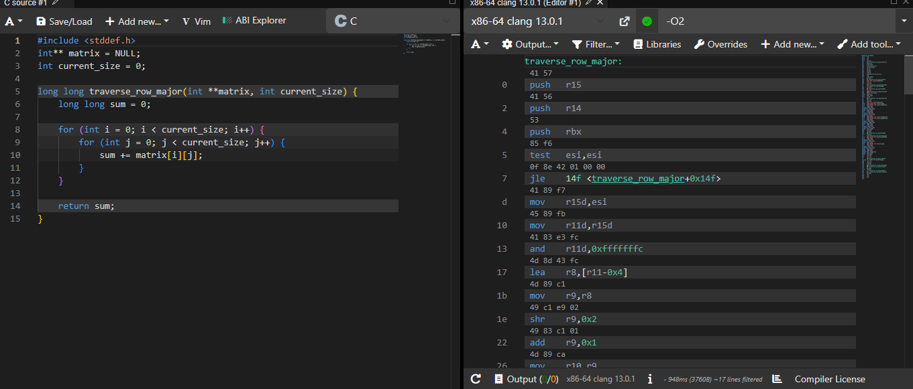
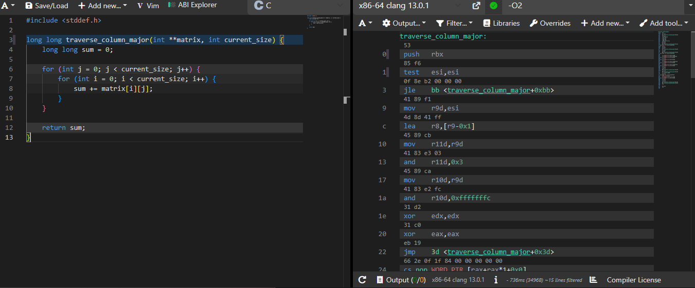

# Cache Behavior Lab Analysis

**Name:** Catherine Jordan Cano

## Section 1: Performace Measurements
The first experiment compared row-major and column-major traversal using four 
different matirx sizes. Both functions produced the same sum, which confirms
that they are performing the same calculation. However, column-major traversals 
took longer, especially as the matrix increased. 

Matrix Size     Row-Major(ms)     Column-Major(ms)     Ratio(Col/Row)
1000 x 1000         2.00                5.00                2.50x
2000 x 2000         17.00               43.00               2.53x
4000 x 4000         39.00               484.00              12.41x
8000 x 8000         109.00              1146.00             10.51x

The results show that row-major traversal was faster for every matrix size.
The difference became especially noticeable with the larger matrices. For 
the 8000 x 8000 matrix, column-major traversal took 10.51 times longer than row-major traversal.
## Section 2: Optimization Level Comparison
The program was teested using three compiler optimization levels: -O0, -O2, 
-O3. These settings allow us to compare how compiler optimization affects the execution time of both traversal methods.
Optimization     Matix Size     Row-Major(ms)     Column-Major(ms)     Ratio
-O0              1000 x 1000        0.00               15.00           N/A
-O0              2000 x 2000        17.00              65.00           3.82x
-O0              4000 x 4000        24.00              689.00          28.71x
-O0              8000 x 8000        131.00             2056.00         15.69x
-O2              1000 x 1000        1.00               8.00            8.00x
-O2              2000 x 2000        0.00               59.00           N/A
-O2              4000 x 4000        15.00              541.00          36.07x
-O2              8000 x 8000        58.00              1823.00         31.43x
-O3              1000 x 1000        0.00               7.00            N/A
-O3              2000 x 2000        3.00               62.00           20.67x
-O3              4000 x 4000        6.00               424.00          70.67x
-O3              8000 x 8000        45.00              2494.00         55.42x
No, -O3 does not eliminate the performance gab between row-major and
column-major traversal. Although compiler optimization improves execution
speed in some cases, column0major traversal still takes significantly longer because it accesses memory in a less effcient order. This shows that cache behavior can have a major effect on performance even when compiler optimization is enabled.

## Section 3: Assembly Analysis
**Row-Major Assembly Screenshot:**

**Column-Major Assembly Screenshot:**

**Assembly Comparison:**
The two functions generate relatively similar assembly instructions because 
they both perform the same calcualtion. Both functions load values from 
memory, and add them together, and update their loop counters. However, the 
order in which they access memory is different. Even though the assembly 
instructions are similar, their performance is different because of how the 
CPU accesses memory. Row-major traversal accesses nearby memory locations
while column-major traversal jumps between different memory locations. This 
shows that cahce behavior has a major effecton program performance 
## Section 4: Cache Behavior Explanation
C stores two-dimensional arrays in row-major order. This means that all the 
elements in the first row are stored next to each other in memory, followed 
by the elements in the second row, and so on. Row-major traversal takes 
advantage of this layout because it visits elements in the same order they 
are stored. When the CPU needs data, it loads a block of nearby memory 
called cache line. A typical cache line is 64 bytes, which can hold 16 
integers if each integer is 4 bytes. When the program accesses one element, 
the nearby elements aare also brought into the cache. This makes accessing 
the next elements faster because they may already be available.

Column-major traversal is less efficient becuase it visits an entire column 
before moving to the next one. Since C stores the matrix by rows, accessing 
elements down a column means jumping between different memory locations. The
CPU may have to load a new cache line for each access instead of using the 
nearby values already loaded, This creates more cache misses and makes the 
program spend more time waiting for data from memory. As the matrix gets 
larger, this difference becomes more noticeable because the data is less 
likely to fit in the CPU cache.

Compiler optimization can imporve code by reducing unnecessary instructions 
and making loops more efficient. However, it cannot completely eliminate the
problem caused by poor memory access patterns. Even with -O2 and -O3, column-
major traversal still accesses the matrix in an order that does not match 
how C stores it in memory. My performance results showed that column-major 
traversal was much slower, especially with the larger matrices. This    
experiment helped me understnad that efficient programming is not just about 
writing fewer instructions. It is also imprtant to understand how the computer stores and accesses data.

Understanding cache behavior will be important for my final project, which 
involves creating a C program that applies blur and sharpen filters to image
data. I will work with image data stored in memory, so I can use arrays to 
organize and access the pixels. To make my program more efficient, I will 
process the image row by row instead of jumping between different memory
locaations. This will help improve cahce performacne and make applying 
the photo filters faster.